###

<h3 align="left">About Me   </h3>

###

I'm from brasil I'm studying Java and Web desing.

###

<h3>Back-end skills</h3>

###

  
  
  
  
  

#

<h3>Front-end skills</h3>

  
  
  
  
  
  
  
  
  

#

<h3>Tools</h3>

  
  
  
  
  
  
  
  
  
  
  

###

<h3 align="left">Social Media:</h3>

  

### 

###

<picture>
  <source media="(prefers-color-scheme: dark)" srcset="https://raw.githubusercontent.com/RodrigoJPSilva/RodrigoJPSilva/output/pacman-contribution-graph-dark.svg">
  <source media="(prefers-color-scheme: light)" srcset="https://raw.githubusercontent.com/RodrigoJPSilva/RodrigoJPSilva/output/pacman-contribution-graph.svg">
  
</picture>

###
